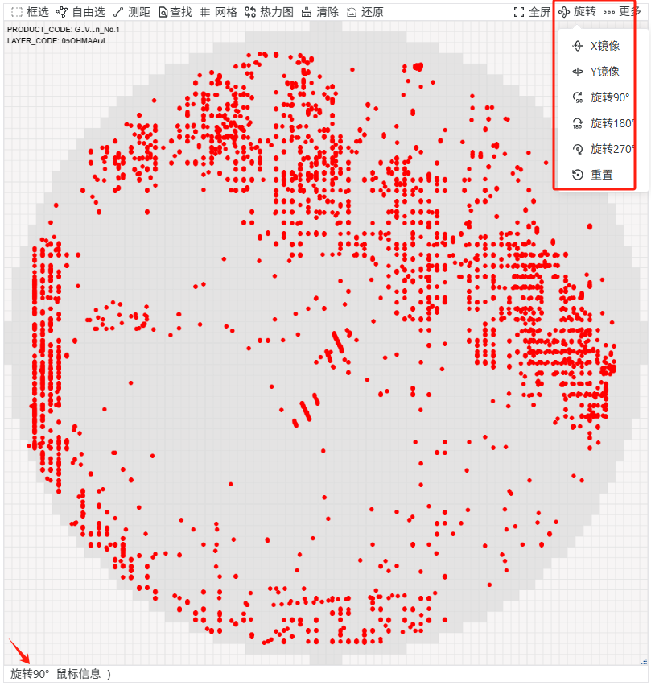

# wafer-widget

基于 Canvas 2D + WebGL 的晶圆图（Wafer Map）渲染与标注组件，提供缩放、平移、标注等完整交互体系，以及半导体晶圆图所需的数据可视化能力。TypeScript 编写，打包为 UMD 模块，无框架依赖，内置页面级渲染队列与大数据分块渲染，可承载十万级 die / defect 数据。



## 功能特性

### 晶圆图渲染

- **三种图表类型**：`wafermap` Die 分布图（WebGL 按图例离散着色）、`heatmap` 热力图（连续色阶 / 离散区间色，big.js 精确区间比较）、`contourmap` 等高线图（反距离加权插值 + 等值线）
- **Die 标记**：按数据字段标记黑色边框、紫色高亮边框、灰色遮罩 + 黄色发光效果；`drawType` 支持双色对角着色
- **Die 数值显示**：直接在格子上绘制取值字段，字号过小（<6px）时自动省略
- **网格参考线**：可开关的 die 网格线，线宽 / 颜色随密度自适应
- **缺陷图（Defect）**：Canvas 2D 渲染，符号（`● ▲ ★ ✦ ⚑ ◉ ■ +` 等）、大小、颜色均支持按条件表达式映射，坐标支持 die 内小数偏移
- **Shot / Reticle 曝光场**：按行列偏移绘制矩形框，稀疏压缩坐标系下自动映射
- **Zone 分区**：按角度 / 半径绘制扇形分区及编号
- **Wafer Summary**：在画布四角任意位置绘制晶圆摘要信息
- **背景图片模式**：waferScan 图片叠加（亮度 / 饱和度 / 对比度 / 旋转可调，按 URL 缓存）

### 交互与标注

- 标注形状：矩形、多边形、折线（测距）、圆形、网格（分区选择）、点、die 点选（ClickSelect）
- **die 点选 / 框选**：单击选中或拖框批量选中 die，支持单选 / 多选模式，`getSelectedDieCoordinates()` 取回原始坐标
- **局部放大**：一次性拖框放大到选中区域（高分辨率源图重绘而非位图拉伸），`clearLocalZoom()` 还原
- 滚轮缩放（以鼠标为中心，受设备 WebGL 安全上限约束）、右键拖拽平移画布、触屏双指缩放
- 标注支持拖拽、控制点微调，编辑控制点时自动弹出圆形放大镜
- 快速查找：按原始坐标标记目标 die（红色描边）
- 图例显隐：单个切换（`toggleLegend`）/ 批量设置（`batchSetLegend`）
- 晶圆旋转与镜像：Notch 方向语义（上 / 下 / 左 / 右 / X 镜像 / Y 镜像），绝对方向、可重复调用；兼容旧版中文键名
- 导出带图例的晶圆图片（JPEG 下载或返回 canvas）

### 性能

- **渲染队列**：重绘请求合并去重；超 5 万点进入页面级共享队列，多实例串行执行，隐藏 / 销毁时安全取消
- **WebGL 上下文复用**：上下文与着色器跨绘制复用（省去每次 12~19ms 固定开销），空闲 30 秒自动释放
- **分块分图层渲染**：按 rect / border / glow / mask 图层 × 5 万点分块生成顶点，避免超大连续内存，块间让出主线程
- **等高线 K 近邻 IDW + 高度场缓存**：10 万控制点高度场计算 ~9.5s → ~90ms（空间分桶逐环收集近邻），数据不变时重绘复用高度场
- **坐标压缩脏标记**：稀疏 waferMap 开启 `compressEmptyRowsColumns` 后剔除空行空列，压缩表只在数据变化时重建
- **悬停命中索引**：die / defect 按 "x_y" 建 Map，鼠标移动 O(1) 查表（10 万 die 从 0.77ms/次降至 0.03ms/次）
- **热力图颜色 memo / defect 符号精灵**：相同值复用颜色（Big.js 只算一次）；符号预渲染后贴图
- **资源治理**：WebGL 缓冲区用后即释；颜色 / 渐变色阶 / 背景图缓存；`setRotate` 免整包深拷贝；`whenRendered()` 等待真实绘制完成
- **渲染暂停**：`setRenderingPaused(true)` 隐藏实例暂停绘制，数据与交互状态完整保留

## 环境要求

- Node.js（rollup 2 构建）
- 浏览器需支持 Canvas 2D 与 WebGL
- 运行时依赖 `big.js` 已内联打包进 UMD 产物，宿主无需额外安装

## 安装

```bash
npm install wafer-widget --save
```

> `lib/` 为构建产物目录，已在 `.gitignore` 中忽略。从源码使用时请先执行 `npm run build` 生成 `lib/wafer-widget.min.js` 及类型声明文件。

## 快速开始

### script 标签引入（UMD）

```html
<script src="./lib/wafer-widget.min.js"></script>
<canvas id="wafer-widget" width="600px" height="600px"></canvas>
<script>
  const wafer = new WaferWidget(document.getElementById('wafer-widget'), waferOptions);
  wafer.updateData(waferData);
  wafer.on('hover', (p) => console.log(p.x, p.y, p.dieData));
</script>
```

### 模块环境引入

```js
import WaferWidget from 'wafer-widget';
```

完整示例见根目录的 [index.html](./index.html)（内嵌示例数据）。执行 `npm run serve` 后访问 <http://127.0.0.1:9999> 即可查看。

### 数据结构概览

`updateData(waferData)` 接收的数据主要包含以下部分：

| 字段 | 说明 |
| --- | --- |
| `waferSummary` | 晶圆摘要键值对，配合 `wsConfig.data` 绘制在画布角落 |
| `waferMap` | Die 数据：`dataList`（每行需含 `_o_<x>` / `_o_<y>` 归一化坐标字段）、`legendList`、`min/max` 值与 `xDieCount` / `yDieCount` 等 |
| `defect` | 缺陷数据：`dataList`（同样使用 `_o_<x>` / `_o_<y>` 坐标）、`legendList` |
| `shot` | Reticle 曝光场 `dataList` |
| `zone` | 分区 `dataList`（含 `minAngleDegrees` / `maxAngleDegrees` / `minRadius` / `maxRadius` / `zoneNo`） |

> `_o_` 前缀字段（如 `position.x` 配置为 `XUI` 时对应 `_o_XUI`）是调用方预先计算好的 0 基准 die 坐标，组件直接使用其绘制、命中检测与旋转变换。

### 常用 API

| 方法 | 说明 |
| --- | --- |
| `updateData(waferData, contextParams?, callbackFn?, isResize?)` | 更新晶圆图数据并重绘；第二参非空视为全新装载（重置旋转/热力图区间） |
| `updateOption(option)` | 合并更新配置并重绘 |
| `redraw()` | 强制重绘晶圆图 |
| `setRotate(angle)` | 镜像 / 旋转（Notch 方向语义，绝对方向） |
| `setLocalZoomMode(enabled)` / `clearLocalZoom()` | 局部放大框选 / 还原完整视图 |
| `setDotSelectionMode(mode)` | die 点选：单选 / 多选 |
| `quickFind(point)` / `getActiveQuickFindPoint()` | 快速定位标记目标 die / 取回最后查找点 |
| `toggleLegend(layer, value, cb)` / `batchSetLegend(layer, values)` | 图例显隐控制 |
| `updateHeatmap(range)` / `setHeatmapRange(range)` / `setHeatmapIntervalSelection(intervals)` / `setHeatmapLegendConfig(mode, count)` | 热力图区间与色阶控制 |
| `setSelectedDies(points)` / `getSelectedDieCoordinates()` | 设置 / 读取选中的 die（原始坐标） |
| `hasDefectsInMarks(point)` / `hasOnlyClickSelectMarks()` | 缺陷命中与标记类型判断 |
| `setCompressEmptyRowsColumns(enabled)` | 稀疏 waferMap 压缩空行列 |
| `getMarksPoints()` | 获取标注覆盖的 die 坐标集合 |
| `whenRendered()` / `prepareExport()` | 等待真实渲染完成 / 导出前恢复完整文本 |
| `setRenderingPaused(paused)` / `getRenderVersion()` | 暂停-恢复渲染 / 渲染版本号（快照失效判断） |
| `saveImage(download?)` | 导出带图例的图片（内部等待渲染完成） |
| `destroy()` / `resize(canvasSize?)` | 销毁 / 重设画布尺寸 |

完整配置项、方法、事件与交互说明见 **[docs/API.md](./docs/API.md)**；上手教程与场景示例见 **[docs/USAGE.md](./docs/USAGE.md)**。

## 交互操作

| 操作 | 方式 |
| --- | --- |
| 缩放 | 鼠标滚轮 / 触屏双指 |
| 平移画布 | 按住右键拖拽 |
| die 点选 / 框选 | `createType = Shape.ClickSelect` 后单击选中 / 拖框批量选中 |
| 局部放大 | `setLocalZoomMode(true)` 后拖框，完成触发 `localZoomComplete` 事件 |
| 创建标注 | 将 `createType` 设为对应 `Shape` 后左键绘制 |
| 结束折线 / 多边形绘制 | 双击（移动端为快速双击屏幕） |
| 回退折线 / 多边形顶点 | `Esc` |
| 删除选中标注 | `Backspace` |
| 调整网格行列 | 选中网格后右键呼出输入框 |
| 切换网格分区选中态 | 双击网格内分区 |
| 暂停画布标注 | 按住 `Ctrl`（可通过 `ctrlCode` 自定义键位），期间左键不创建标注，供宿主接管交互 |

## 本地开发

```bash
npm install        # 安装依赖
npm run dev        # rollup watch 构建 + live-server（端口 9999）
npm run watch      # 仅监听构建
npm run build      # 产出 lib/wafer-widget.min.js（含 sourcemap 与 .d.ts）
npm run serve      # 仅启动演示页服务
```

## 目录结构

```
├── index.html               # 本地演示页（内嵌示例数据 + 新功能演示工具栏）
├── rollup.config.js         # UMD 打包配置（全局变量名 WaferWidget）
├── src/
│   ├── index.ts             # WaferWidget 主类（渲染管线 + 交互 + 公开 API）
│   ├── render-queue.ts      # 页面级 WebGL 渲染队列（并发限制 + 取消）
│   ├── coordinate-compression.ts # 稀疏坐标压缩（空行列剔除）
│   ├── event-bus.ts         # 事件总线（on / emit / off）
│   ├── tools.ts             # 颜色转换、渐变色阶、数值格式化等工具（带缓存）
│   └── shape/               # 标注形状：矩形、多边形、点、折线、圆、网格、ClickSelect、QuickFind
├── docs/
│   ├── USAGE.md             # 使用说明（快速开始 / 场景示例 / 性能指南 / 迁移）
│   └── API.md               # API 参考
└── lib/                     # 构建产物（git 忽略，npm 发布目录）
```

## 许可

[MIT](./package.json)
